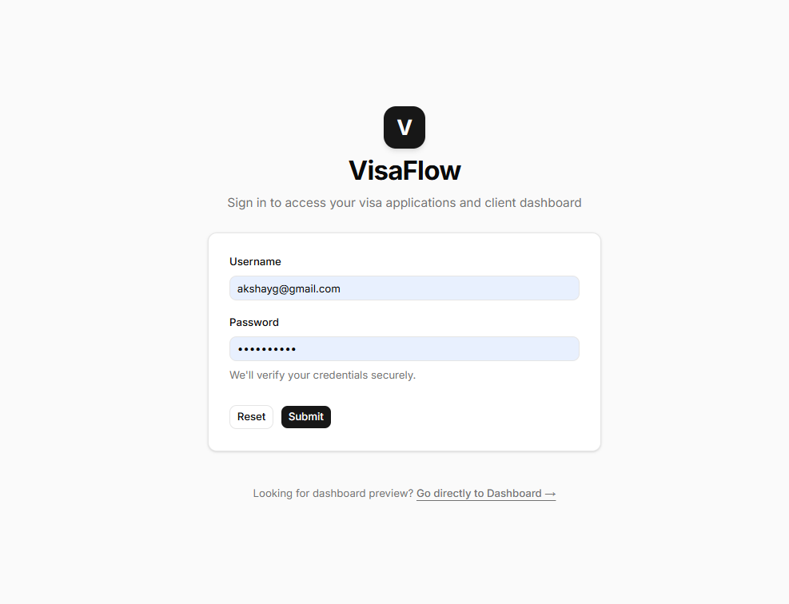
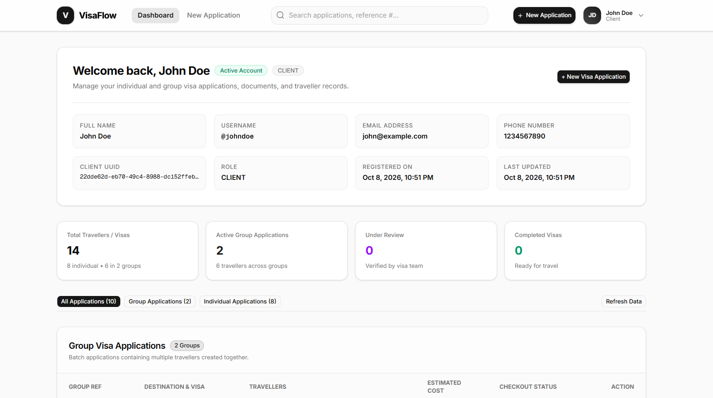
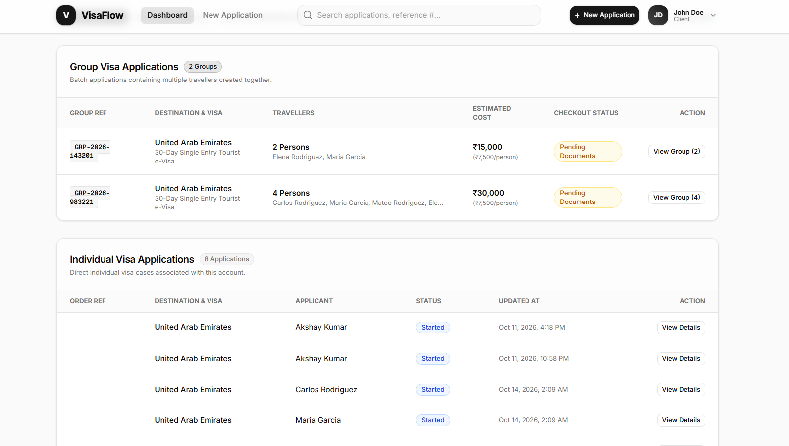
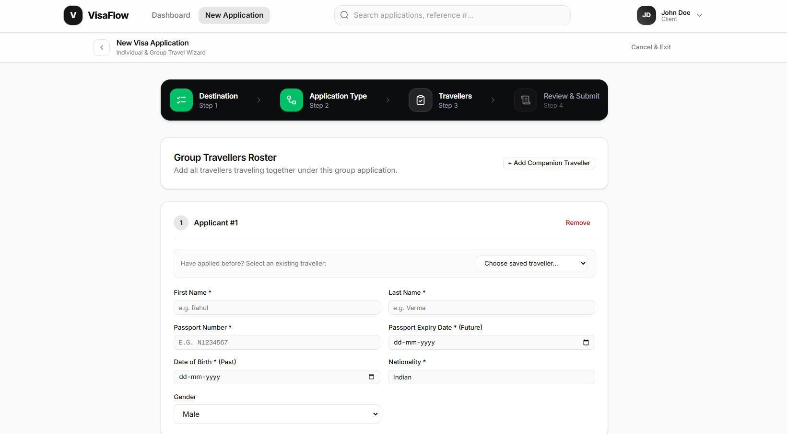
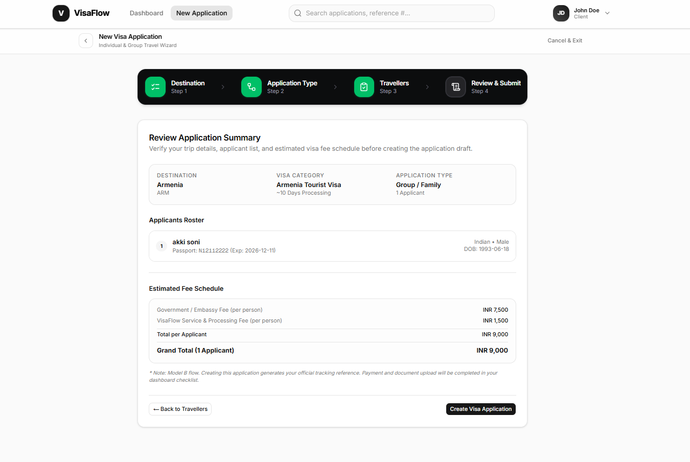
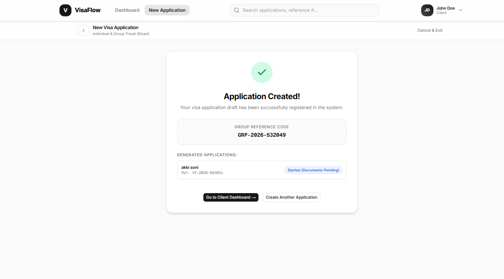
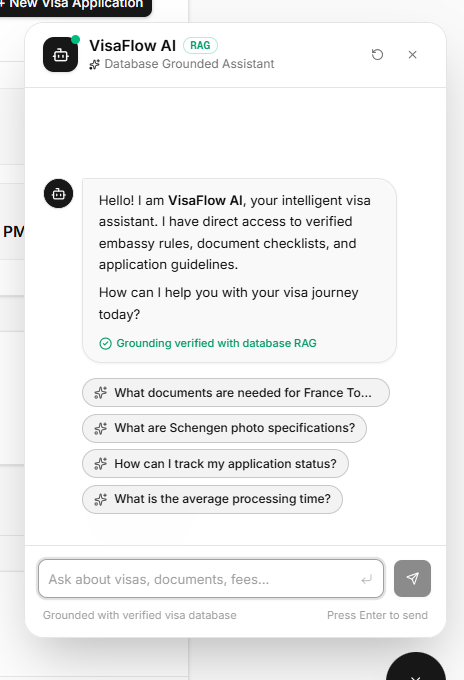

# VisaFlow Frontend

A modern Next.js client application for managing individual and group travel visa applications, document reviews, applicant rosters, real-time status tracking, and AI-assisted visa guidance.

Built with **Next.js 16 (App Router & Turbopack)**, **React 19**, **Tailwind CSS v4**, and **Base UI / Shadcn**.

---

## Application Screenshots & Flow

Here is a visual walkthrough of the main flows in VisaFlow:

### 1. Authentication (`/login`)
Secure client login screen to access the application dashboard.



---

### 2. Client Dashboard Overview (`/dashboard`)
Displays account profile info, total travellers, active group applications, applications under review, and completed visas summary cards.



---

### 3. Application Roster & Management
Filtered view for **Group Visa Applications** (with per-group reference numbers, traveller count, estimated cost, and checkout status) alongside **Individual Visa Applications**.



---

### 4. New Application Wizard - Travellers Roster (`/dashboard/new-application`)
Multi-step wizard allowing single applicant or companion travellers to be added, with passport details, expiry, date of birth, and nationality.



---

### 5. Application Summary & Estimated Fee Schedule
Comprehensive pre-submission summary displaying destination category, applicant roster, itemized embassy fees, and service charges.



---

### 6. Application Draft Created Confirmation
Instant group reference code generation (`GRP-YYYY-XXXXXX`) and individual tracking references ready for document upload and checkout.



---

### 7. AI Chatbot Assistant (Database RAG Grounded)
Interactive floating assistant widget grounded with verified embassy visa rules and database RAG. Supports multi-turn conversation history, live typing indicators, clickable follow-up suggestion chips, markdown table/checklist rendering, and automatic page context detection (country destination & application reference numbers).



---

## Tech Stack

- **Framework**: [Next.js 16](https://nextjs.org/) (App Router, Turbopack)
- **UI Library**: [React 19](https://react.dev/)
- **Styling**: [Tailwind CSS v4](https://tailwindcss.com/)
- **Components**: [Base UI](https://base-ui.com/), [Shadcn](https://ui.shadcn.com/)
- **Icons**: [Lucide React](https://lucide.dev/), [Hugeicons](https://hugeicons.com/)
- **Markdown & AI**: [React Markdown](https://github.com/remarkjs/react-markdown), [Remark GFM](https://github.com/remarkjs/remark-gfm)

---

## Getting Started

### Prerequisites

- Node.js 20.9+ installed
- npm (or pnpm / yarn / bun)

### Installation

1. Install dependencies:
   ```bash
   npm install
   ```

2. Run development server:
   ```bash
   npm run dev
   ```

3. Open [http://localhost:3000](http://localhost:3000) in your browser.

---

## Available Scripts

- `npm run dev` - Starts the Next.js development server with Turbopack.
- `npm run build` - Creates an optimized production build.
- `npm run start` - Starts the Next.js production server.
- `npm run lint` - Runs ESLint.
